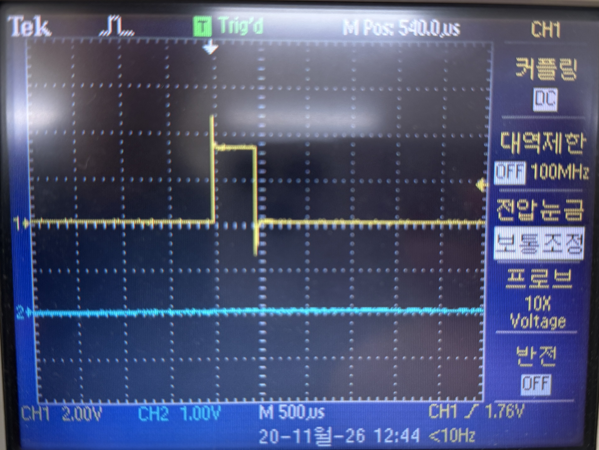
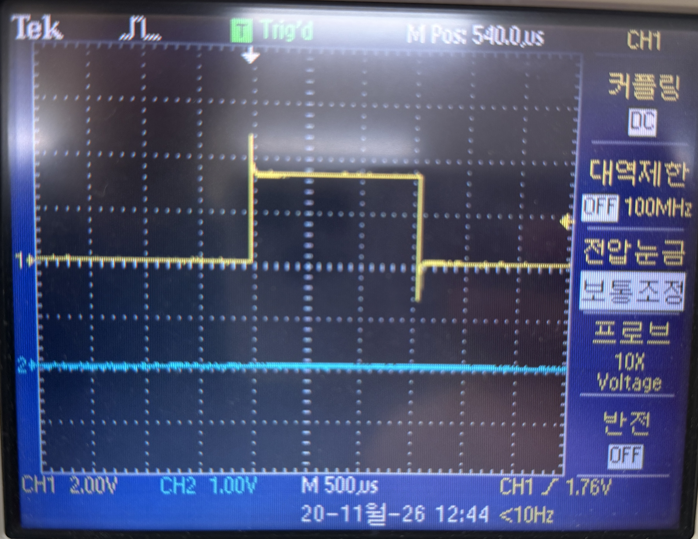
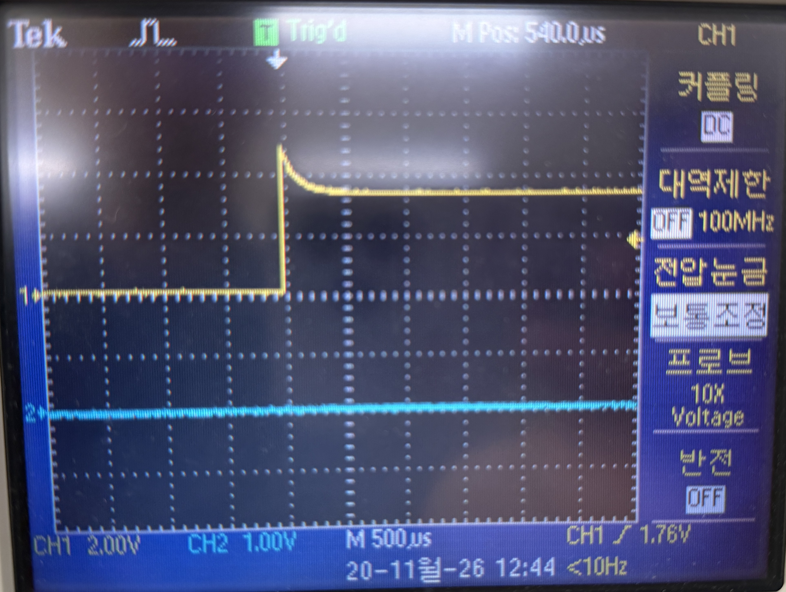

# 03. FreeRTOS — 초음파 + 온습도 태스크 분리

[01. HC-SR04 STEP02 거리측정2](../01_HC-SR04_STEP02_2) 의 초음파 측정과 [02. DHT11](../02_DHT11) 의 온습도 측정을 **FreeRTOS 태스크 2개**로 나눠 동시에 실행하고, 온습도로 계산한 **음속으로 초음파 거리를 보정**

- 수업 자료 : [gotree94/STM32 STEP04_FreeRTOS2 (NUCLEO-F411RE)](https://github.com/gotree94/STM32/blob/main/NUCLEO_F411RE/00.F411_TASK_LAB/STEP04_FreeRTOS2.md)
- MCU : STM32F411RETx / 84 MHz / NUCLEO-F411RE
- 빌드 : 0 errors, 0 warnings — `F411_LAB.elf` text 34400 / data 108 / bss 22092

## Table of Contents
- [1. 전체 작업 흐름](#1-전체-작업-흐름)
- [2. CubeMX에서 실제 반영된 설정](#2-cubemx에서-실제-반영된-설정)
- [3. 코드 변경 내용](#3-코드-변경-내용)
- [4. 태스크 동작 타이밍](#4-태스크-동작-타이밍)
- [5. 시리얼 출력](#5-시리얼-출력)
- [6. ECHO 파형](#6-echo-파형)

---

## 1. 전체 작업 흐름

| 단계 | 내용 |
|---|---|
| [01. STEP02 거리측정2](../01_HC-SR04_STEP02_2) | HC-SR04 거리 측정 + `D`, `C` 출력 + SWV 트레이스 |
| [02. DHT11](../02_DHT11) | DHT11 온습도 측정 (PA4) |
| **03. FreeRTOS (이번)** | CubeMX 에서 FreeRTOS 추가 → 초음파 / DHT 태스크 분리, UART mutex, 음속 보정, `TH` / `ENV` / `S` 출력 |

---

## 2. CubeMX에서 실제 반영된 설정

### 2.1 Middleware / NVIC / Clock

| 항목 | 최종 값 | 비고 |
|---|---|---|
| FREERTOS Interface | `CMSIS_V2` | `VP_FREERTOS_VS_CMSIS_V2.Mode=CMSIS_V2` |
| `configTOTAL_HEAP_SIZE` | `16384` | 태스크 3개 + mutex 여유 |
| `configTICK_RATE_HZ` | 1000 | 1 ms tick |
| `configUSE_PREEMPTION` | 1 | 선점형 스케줄링 |
| `configUSE_MUTEXES` | 1 | `myMutex01` 사용 |
| `configLIBRARY_MAX_SYSCALL_INTERRUPT_PRIORITY` | 5 | EXTI 우선순위 5 와 맞춤 |
| NVIC Priority Group | `NVIC_PRIORITYGROUP_4` | 4 bits for pre-emption priority |
| EXTI0 / EXTI15_10 우선순위 | **5** | `HAL_NVIC_SetPriority(..., 5, 0)` 로 생성됨 (이전 0) |
| SysTick / PendSV 우선순위 | 15 | `TICK_INT_PRIORITY 15U` |
| SYS Timebase Source | **SysTick 유지** | 아래 참고 |
| Heap / Port | `heap_4`, `ARM_CM4F` | CubeMX 생성 |

> **SysTick 유지 :** 생성된 `stm32f4xx_it.c` 의 `SysTick_Handler()` 가 `HAL_IncTick()` 과 `xPortSysTickHandler()` 를 **함께 호출**하고, `FreeRTOSConfig.h` 의 `USE_CUSTOM_SYSTICK_HANDLER_IMPLEMENTATION 1` 로 `cmsis_os2.c` 의 중복 핸들러가 꺼짐 → SysTick 을 그대로 써도 충돌 없음

### 2.2 태스크 / 뮤텍스 (실제 생성된 값)

| 이름 | 우선순위 | 스택 | Entry 함수 | 역할 |
|---|---|---|---|---|
| `defaultTask` | 24 (Normal) | 128 words | `StartDefaultTask` | 대기용, `osDelay(1)` |
| `myTask02` | 17 (BelowNormal1) | 256 words | `StartUltrasonicTask` | 초음파 폴링 + `D` / `C` 출력 |
| `myTask03` | 25 (Normal1) | 256 words | `StartDhtTask` | DHT 읽기 + `TH` / `ENV` / `S` 출력 + 음속 갱신 |
| `myMutex01` | Dynamic | — | — | UART (`printf`) 접근 직렬화 |

- 태스크 함수는 `freertos.c` 가 아니라 **`main.c`** 안에 생성됨
- `main()` 에서 `osKernelInitialize()` → `osMutexNew()` → `osThreadNew()` 3회 → `osKernelStart()` 순서로 생성
- DHT 태스크가 초음파 태스크보다 우선순위가 높음 → DHT 를 읽는 약 25 ms 동안 초음파 태스크가 끼어들지 않아 DHT 비트 타이밍이 깨지지 않음

### 2.3 유지한 설정

- `TIM1` : Prescaler `84-1`, ARR `65535` → 1 MHz 카운터 (초음파 + DHT 공용 µs 기준)
- `USART2` : 115200-8N1, PA2 / PA3
- GPIO : PA0 ECHO (EXTI 양쪽 에지), PA1 TRIG, **PA4 DHT DATA** (GPIO_Output, `dht.c` 가 런타임에 출력 ↔ 입력 전환), PA5 LD2, PC13 B1

---

## 3. 코드 변경 내용

[02. DHT11](../02_DHT11) 마지막 코드 기준으로 바뀐 부분만 정리

### 3.1 CubeMX 가 생성한 부분

| 파일 | 변경 |
|---|---|
| `main.c` | `#include "cmsis_os.h"`, 태스크 / mutex 정의, `osKernelInitialize()` ~ `osKernelStart()`, EXTI 우선순위 0 → 5 |
| `stm32f4xx_it.c` | `SysTick_Handler()` 에 `xPortSysTickHandler()` 추가, `SVC_Handler` / `PendSV_Handler` 제거 (FreeRTOS port 가 사용) |
| `stm32f4xx_hal_msp.c` | `NVIC_PRIORITYGROUP_0` 설정 제거 (HAL_Init 의 Group 4 사용), PendSV 우선순위 15 |
| `stm32f4xx_hal_conf.h` | `TICK_INT_PRIORITY` 0 → 15 |
| `FreeRTOSConfig.h`, `freertos.c`, `Middlewares/Third_Party/FreeRTOS/**` | 새로 생성 |

### 3.2 직접 수정한 부분

| 위치 | 변경 |
|---|---|
| `main.c` Includes | `#include "dht.h"` 추가 |
| `main.c` PFP / USER CODE 0 | `Sensor_SoundSpeedX10()` 추가 (온습도 → 음속) |
| `main.c` USER CODE 2 | `HAL_NVIC_DisableIRQ(EXTI0_IRQn)` 제거 (초음파 다시 사용), `HAL_TIM_Base_Start(&htim1)` → `Ultrasonic_Init()` + `Dht_Init()` |
| `main.c` USER CODE 4 | EXTI 콜백에 ECHO → `Ultrasonic_OnEchoEdge()` 다시 추가 |
| `main.c` 태스크 함수 | `StartUltrasonicTask`, `StartDhtTask` 구현 |
| `dht.c` | µs 시간 기준을 `TIM2->CNT` → **`TIM1->CNT`** (16비트) 로 변경 |

- `Ultrasonic_Init()` 안에서 `HAL_TIM_Base_Start(&htim1)` 를 하므로 USER CODE 2 에서 따로 시작하지 않음 (두 번 시작하면 `HAL_ERROR` → `Error_Handler()`)
- `osKernelStart()` 이후에는 스케줄러가 CPU 를 점유 → `while(1)` 안의 기존 DHT11 코드는 실행되지 않음

### 3.3 Includes

```c
/* USER CODE BEGIN Includes */
#include <stdio.h>
#include <string.h>
#include "ultrasonic.h"
#include "dht.h"


/* USER CODE END Includes */
```

### 3.4 태스크 / 뮤텍스 정의 (CubeMX 생성)

```c
/* Definitions for defaultTask */
osThreadId_t defaultTaskHandle;
const osThreadAttr_t defaultTask_attributes = {
  .name = "defaultTask",
  .stack_size = 128 * 4,
  .priority = (osPriority_t) osPriorityNormal,
};
/* Definitions for myTask02 */
osThreadId_t myTask02Handle;
const osThreadAttr_t myTask02_attributes = {
  .name = "myTask02",
  .stack_size = 256 * 4,
  .priority = (osPriority_t) osPriorityBelowNormal1,
};
/* Definitions for myTask03 */
osThreadId_t myTask03Handle;
const osThreadAttr_t myTask03_attributes = {
  .name = "myTask03",
  .stack_size = 256 * 4,
  .priority = (osPriority_t) osPriorityNormal1,
};
/* Definitions for myMutex01 */
osMutexId_t myMutex01Handle;
const osMutexAttr_t myMutex01_attributes = {
  .name = "myMutex01"
};
```

### 3.5 음속 보정 함수 (USER CODE 0)

```c
// 온도 / 습도로 음속 계산 (단위 : 0.1 m/s)
// c ≈ 331.3 + 0.606 × T(°C) + 0.0124 × RH(%)  [m/s]
// 입력이 ×10 단위이므로 : c_x10 = 3313 + 0.606 × T_x10 + 0.0124 × RH_x10
uint16_t Sensor_SoundSpeedX10(int16_t temperature_c_x10, uint16_t humidity_rh_x10)
{
  int32_t speed_x10 = 3313
                    + ((int32_t)temperature_c_x10 * 606) / 1000
                    + ((int32_t)humidity_rh_x10 * 124) / 10000;

  return (uint16_t)speed_x10;   // 범위 검사(250.0 ~ 400.0 m/s)는 Ultrasonic_SetSoundSpeedX10() 에서 함
}
```

- 예 : 23.5 °C, 53.0 %RH → 3313 + 142 + 6 = **3461** (346.1 m/s)
- `Ultrasonic_SetSoundSpeedX10()` 가 2500 ~ 4000 (250.0 ~ 400.0 m/s) 범위만 받아들임

### 3.6 USER CODE 2

```c
  /* USER CODE BEGIN 2 */
  // DHT11 핀 초기 설정
  DHT11_SetPinOutput();
  DHT11_SetPin(GPIO_PIN_SET);  // 초기에 HIGH로 설정
  HAL_Delay(1000);  // DHT11 안정화 시간


  // 초음파 / DHT11 모듈 초기화 (Ultrasonic_Init 안에서 TIM1 시작 → 여기서 따로 시작하면 HAL_ERROR)
  Ultrasonic_Init();
  Dht_Init();

  // UART 초기화 메시지
  sprintf(uart_buffer, "DHT11 Temperature & Humidity Sensor Test\r\n");
  HAL_UART_Transmit(&huart2, (uint8_t*)uart_buffer, strlen(uart_buffer), HAL_MAX_DELAY);

  /* USER CODE END 2 */
```

### 3.7 스케줄러 시작 (CubeMX 생성)

```c
  /* Init scheduler */
  osKernelInitialize();
  /* Create the mutex(es) */
  /* creation of myMutex01 */
  myMutex01Handle = osMutexNew(&myMutex01_attributes);

  /* USER CODE BEGIN RTOS_MUTEX */
  /* add mutexes, ... */
  /* USER CODE END RTOS_MUTEX */

  /* USER CODE BEGIN RTOS_SEMAPHORES */
  /* add semaphores, ... */
  /* USER CODE END RTOS_SEMAPHORES */

  /* USER CODE BEGIN RTOS_TIMERS */
  /* start timers, add new ones, ... */
  /* USER CODE END RTOS_TIMERS */

  /* USER CODE BEGIN RTOS_QUEUES */
  /* add queues, ... */
  /* USER CODE END RTOS_QUEUES */

  /* Create the thread(s) */
  /* creation of defaultTask */
  defaultTaskHandle = osThreadNew(StartDefaultTask, NULL, &defaultTask_attributes);

  /* creation of myTask02 */
  myTask02Handle = osThreadNew(StartUltrasonicTask, NULL, &myTask02_attributes);

  /* creation of myTask03 */
  myTask03Handle = osThreadNew(StartDhtTask, NULL, &myTask03_attributes);

  /* USER CODE BEGIN RTOS_THREADS */
  /* add threads, ... */
  /* USER CODE END RTOS_THREADS */

  /* USER CODE BEGIN RTOS_EVENTS */
  /* add events, ... */
  /* USER CODE END RTOS_EVENTS */

  /* Start scheduler */
  osKernelStart();

  /* We should never get here as control is now taken by the scheduler */
```

### 3.8 EXTI 콜백

```c
/* USER CODE BEGIN 4 */
void HAL_GPIO_EXTI_Callback(uint16_t GPIO_Pin)
{
  if (GPIO_Pin == ECHO_Pin)
  {
    Ultrasonic_OnEchoEdge();
  }
  else if (GPIO_Pin == B1_Pin)
  {
    HAL_GPIO_TogglePin(LD2_GPIO_Port, LD2_Pin);
  }
}
/* USER CODE END 4 */
```

- EXTI 우선순위 5 → `configLIBRARY_MAX_SYSCALL_INTERRUPT_PRIORITY` 와 같음 → RTOS 와 같이 써도 안전
- 콜백은 TIM1 카운터만 읽고 끝남 (RTOS API, `printf` 호출 없음)

### 3.9 태스크 함수 (`/* USER CODE END 4 */` 아래)

```c
/* USER CODE BEGIN Header_StartDefaultTask */
/**
  * @brief  Function implementing the defaultTask thread.
  * @param  argument: Not used
  * @retval None
  */
/* USER CODE END Header_StartDefaultTask */
void StartDefaultTask(void *argument)
{
  /* USER CODE BEGIN 5 */
  /* Infinite loop */
  for(;;)
  {
    osDelay(1);
  }
  /* USER CODE END 5 */
}
```

```c
/* USER CODE BEGIN Header_StartUltrasonicTask */
/**
* @brief Function implementing the myTask02 thread.
* @param argument: Not used
* @retval None
*/
/* USER CODE END Header_StartUltrasonicTask */
void StartUltrasonicTask(void *argument)
{
  /* USER CODE BEGIN StartUltrasonicTask */
  Ultrasonic_Result result;
  char line[80];

  for(;;)
  {
    Ultrasonic_Task();

    if (Ultrasonic_GetResult(&result) != 0U)
    {
      (void)snprintf(line, sizeof(line), "D,%lu,%u,%u,%lu\n",
                     (unsigned long)result.timestamp_ms,
                     (unsigned int)result.distance_mm,
                     (unsigned int)result.valid,
                     (unsigned long)result.errors);

      (void)osMutexAcquire(myMutex01Handle, osWaitForever);
      printf("%s", line);
      printf("C,%u\n", (unsigned int)Ultrasonic_GetLastEchoTicks());
      (void)osMutexRelease(myMutex01Handle);
    }

    osDelay(10);
  }
  /* USER CODE END StartUltrasonicTask */
}
```

```c
/* USER CODE BEGIN Header_StartDhtTask */
/**
* @brief Function implementing the myTask03 thread.
* @param argument: Not used
* @retval None
*/
/* USER CODE END Header_StartDhtTask */
void StartDhtTask(void *argument)
{
  /* USER CODE BEGIN StartDhtTask */
  Dht_Result dht;
  char line[96];
  int32_t temperature;
  uint16_t speed_x10;

  for(;;)
  {
    Dht_Task();

    if (Dht_GetResult(&dht) != 0U)
    {
      temperature = (int32_t)dht.temperature_c_x10;
      (void)snprintf(line, sizeof(line), "TH,%lu,%d,%u,%u,%lu\n",
                     (unsigned long)dht.timestamp_ms,
                     (int)temperature,
                     (unsigned int)dht.humidity_rh_x10,
                     (unsigned int)dht.valid,
                     (unsigned long)dht.errors);

      (void)osMutexAcquire(myMutex01Handle, osWaitForever);
      printf("%s", line);
      printf("ENV,%c%u.%uC,%u.%u%%RH\n",
             (temperature < 0) ? '-' : '+',
             (unsigned int)((temperature < 0) ? -temperature : temperature) / 10U,
             (unsigned int)((temperature < 0) ? -temperature : temperature) % 10U,
             (unsigned int)dht.humidity_rh_x10 / 10U,
             (unsigned int)dht.humidity_rh_x10 % 10U);

      if (dht.valid != 0U)
      {
        speed_x10 = Sensor_SoundSpeedX10(dht.temperature_c_x10,
                                         dht.humidity_rh_x10);
        Ultrasonic_SetSoundSpeedX10(speed_x10);
        printf("S,%u\n", (unsigned int)speed_x10);
      }
      (void)osMutexRelease(myMutex01Handle);
    }

    osDelay(100);
  }
  /* USER CODE END StartDhtTask */
}
```

### 3.10 `dht.c` : µs 시간 기준을 TIM1 으로

```c
// TIM1 (1 MHz, 16비트) 사용 : 이 프로젝트에는 TIM2 가 없음
// 카운터는 리셋하지 않고 읽기만 함 → 초음파 측정과 같이 써도 됨
// 16비트라서 경과 시간은 (uint16_t) 뺄셈으로 계산 (최대 65535 µs)
static uint32_t DHT_NowUs(void)
{
  return (uint16_t)TIM1->CNT;
}

static void DHT_DelayUs(uint32_t us)
{
  uint32_t start = DHT_NowUs();

  while ((uint16_t)(DHT_NowUs() - start) < us)
  {
  }
}

static uint8_t DHT_WaitLevel(GPIO_PinState level, uint32_t timeout_us, uint32_t *duration)
{
  uint32_t start = DHT_NowUs();

  while (HAL_GPIO_ReadPin(DHT_PORT, DHT_PIN) != level)
  {
    if ((uint16_t)(DHT_NowUs() - start) >= timeout_us)
    {
      return 0U;
    }
  }

  if (duration != NULL)
  {
    *duration = (uint16_t)(DHT_NowUs() - start);
  }

  return 1U;
}
```

- 카운터를 **리셋하지 않고 읽기만** 함 → 초음파(`ultrasonic.c`) 와 같은 TIM1 을 동시에 써도 서로 영향 없음
- `(uint16_t)(now - start)` → 65535 → 0 으로 넘어가도 경과 시간이 맞게 계산됨

---

## 4. 태스크 동작 타이밍

```text
[FreeRTOS 1 ms tick]
 myTask03 (DHT, 25)  : 100 ms 마다 Dht_Task() → 내부 2 s 게이트 → 실제 읽기 2 s 마다 1회 (약 25 ms 블로킹)
 myTask02 (US, 17)   : 10 ms 마다 Ultrasonic_Task() → 200 ms 샘플 / 1000 ms 출력 → D, C 1 Hz
 defaultTask (24)    : osDelay(1) 대기
 ISR (EXTI0, 5)      : ECHO 에지에서 TIM1 카운터만 읽어 펄스 폭 저장
```

- DHT 가 약 25 ms 블로킹해도 초음파 샘플 주기(200 ms)보다 짧고, ECHO 펄스 폭은 인터럽트에서 재므로 측정값에 영향 없음
- 음속 값(`uint16_t`) 은 DHT 태스크가 쓰고 초음파 태스크가 읽음 → 32비트 코어에서 16비트 대입은 한 번에 끝나므로 별도 동기화 불필요
- `printf` 는 두 태스크 모두 `myMutex01` 안에서만 호출 → 줄이 섞이지 않음

---

## 5. 시리얼 출력

115200-8N1, COM7

| 프리픽스 | 형식 | 주기 |
|---|---|---|
| `D` | `D,<time_ms>,<distance_mm>,<valid>,<errors>` | 1 s (음속 보정 적용) |
| `C` | `C,<echo_ticks>` | 1 s (ECHO 폭, 1 tick = 1 µs) |
| `TH` | `TH,<time_ms>,<temp_x10>,<rh_x10>,<valid>,<errors>` | 2 s |
| `ENV` | `ENV,<+/-><T>.<t>C,<RH>.<r>%RH` | 2 s |
| `S` | `S,<speed_x10>` | 2 s (DHT 값이 유효할 때만) |

### 5.1 실제 출력

```text
S,3460
D,31425,1798,1,0
C,10395
D,32428,1798,1,0
C,10394
TH,33425,235,530,1,0
ENV,+23.5C,53.0%RH
```

| 출력 | 의미 |
|---|---|
| `D,31425,1798,1,0` | 31.425 s, 거리 **1798 mm**, 유효, 오류 0 |
| `C,10395` | ECHO 펄스 폭 10395 µs |
| `TH,33425,235,530,1,0` | 33.425 s, **23.5 °C**, **53.0 %RH**, 유효, 오류 0 |
| `ENV,+23.5C,53.0%RH` | `TH` 값을 읽기 쉽게 다시 출력 |
| `S,3460` | 직전 DHT 측정으로 계산한 음속 **346.0 m/s** (`ENV` 다음 줄에 출력) |

- `D` / `C` 는 1초, `TH` / `ENV` / `S` 는 2초 주기라서 두 태스크 출력이 섞여서 나옴
- 줄이 중간에 끊기지 않음 → mutex 로 UART 접근이 직렬화됨

### 5.2 음속 보정 확인

같은 ECHO 폭 `C,10395` 로 계산

| 음속 | 계산 | 거리 |
|---|---|---:|
| 기본 343.0 m/s | 10395 × 3430 / 20000 | 1782 mm |
| **보정 346.0 m/s** (`S,3460`) | 10395 × 3460 / 20000 | **1798 mm** |

- 출력된 `D` 의 1798 mm 와 일치 → DHT 온습도 → 음속 계산 → 초음파 거리 보정까지 연결됨

---

## 6. ECHO 파형

FreeRTOS 로 바꾼 뒤에도 초음파 ECHO 가 정상으로 나오는지 오실로스코프로 확인

- 설정 : CH1 = ECHO (PA0, 분압 후), 2.00 V/div, 시간축 **500 µs/div**, 트리거 CH1 상승 에지 1.76 V

  

| 왼쪽 : 가까울 때 | 가운데 : 중간 | 오른쪽 : 멀 때 |
|---|---|---|
| HIGH 약 0.9칸 ≈ **0.47 ms** | HIGH 약 3.2칸 ≈ **1.6 ms** | HIGH 가 화면 끝까지 이어짐 → **3 ms 이상** |
| ≈ 8 cm | ≈ 27 cm | ≈ 52 cm 이상 |

- 거리(mm) ≈ 펄스 폭(µs) × 3460 / 20000 → 폭은 화면 눈금으로 읽은 대략값
- HIGH 높이 약 1.6 ~ 1.7칸 ≈ **3.3 V** → 5 V ECHO 가 분압으로 PA0 에 안전한 전압으로 들어옴
- 물체가 멀어질수록 HIGH 폭만 길어지고 높이는 그대로
